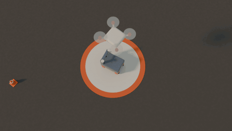
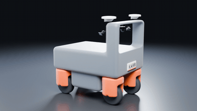

<div align="center">

# K.A.R.R

### Keystone Autonomous Resource Rover

**An autonomous indoor/outdoor research robot with four independently steered wheels and moderate load carrying capability.**


</div>

<p align="center">
  
  <br><sub><a href="media/karr_mission.mp4">Watch in HD</a> · rendered from the robot's CAD model (<a href="media/README.md">how</a>)</sub>
</p>

<table>
<tr>
<td width="44%" align="center">
  
  <br><sub><a href="media/karr.stl"><b>Rotate the 3D model</b></a> · rendered from the CAD model (<a href="media/README.md">how</a>)</sub>
</td>
<td>

**Drive** · 4 independently steered and driven wheels, coordinated in software as Ackermann steering.
Front-wheel steering this year; double Ackermann when the rear steering motors are fitted.

**Lidar** · Livox Mid-360, 360° × 59°

**Cameras** · 3 × Stereolabs ZED X One S, wide lens

**GNSS** · Dual u-blox ZED-F9P RTK (ArduSimple simpleRTK2B heading kit)

**Computer** · NVIDIA Jetson AGX Orin

**Software** · ROS 2 Jazzy, Gazebo Harmonic, ros2_control

</td>
</tr>
</table>

## Try it

Any laptop with Docker (Windows, macOS, Linux; x86 or ARM):

```bash
git clone <repo-url> karr_robot && cd karr_robot
./dev.sh sim          # Windows PowerShell: .\dev.ps1 sim
```

Gazebo, rviz and a keyboard teleop window open. On macOS they show up in the browser at
<http://localhost:6080/vnc.html?autoconnect=1&resize=remote>.

<details>
<summary><b>Repository layout</b></summary>

```
karr_robot/
├── karr_description/   URDF, meshes, rviz view                         (ROS 2 package)
├── karr_control/       Steering kinematics, odometry, ros2_control, teleop (ROS 2 package)
├── karr_gazebo/        Gazebo worlds, simulated sensors, sim launch     (ROS 2 package)
├── urdf_prep/          SolidWorks export + converter tools (Windows side, ignored by colcon)
├── media/              README animations (Blender) and the 3D model file
├── docker/             Dev container (ROS 2 Jazzy, Ubuntu 24.04, amd64 + arm64)
├── dev.sh              Container helper for Linux / macOS / WSL
└── dev.ps1             Container helper for Windows PowerShell
```

New ROS 2 packages go at the top level. Other repos (drivers etc.) can be added as git submodules anywhere in the tree;
colcon finds packages recursively. Each package has its own README with the details.

</details>

<details>
<summary><b>Build on the robot or an Ubuntu 24.04 machine</b></summary>

```bash
mkdir -p ~/ros2_ws/src && cd ~/ros2_ws/src
git clone --recurse-submodules <repo-url> karr_robot
cd ~/ros2_ws
rosdep install --from-paths src --ignore-src -y
colcon build --symlink-install
source install/setup.bash
ros2 launch karr_description display.launch.py
```

</details>

<details>
<summary><b>Dev container</b></summary>

Needs Docker (Docker Desktop on Windows/macOS). The image builds natively for the host: x86_64 laptops, Apple Silicon
and Jetson all use the same Dockerfile. Inside the container the repo is mounted at `~/ros2_ws/src/karr_robot`, the same
layout as on the robot; `build/ install/ log/` live in a Docker volume.

```bash
./dev.sh build      # first time, ~10-15 min
./dev.sh sim        # Gazebo simulation
./dev.sh display    # rviz2 + joint sliders only
./dev.sh shell      # bash with ROS sourced
```

Windows: same commands with `.\dev.ps1` (run `Set-ExecutionPolicy -Scope CurrentUser RemoteSigned` once if blocked).

| Command | What it does |
| --- | --- |
| `build` | Build the image |
| `up` / `down` | Start / stop the container (`down` keeps the build volume) |
| `shell` | bash in the container |
| `colcon [args]` | `colcon build --symlink-install` |
| `deps` | `rosdep install` for every package in the repo |
| `sim [args]` | Build, then `ros2 launch karr_gazebo sim.launch.py` |
| `teleop` | Keyboard teleop in the current terminal |
| `display [args]` | Build, then `ros2 launch karr_description display.launch.py` |
| `test` | Build and run package tests |
| `verify` | Regenerate the URDF from the SolidWorks export and run all checks (see `urdf_prep/`) |
| `glxtest` | Show which OpenGL renderer the container uses |
| `reset` | Remove container and build volume |

**GUI.** Picked automatically; override with `KARR_GUI=x11|wslg|vnc|none`.

| Host | Default | How it shows |
| --- | --- | --- |
| Ubuntu (desktop session) | `x11` | Native windows via the host X server. Also uses host networking, so ROS 2 topics reach the robot on the LAN. |
| Windows 11 (PowerShell) | `wslg` | Native windows through WSLg. Needs Docker Desktop with the WSL 2 engine. |
| macOS, or anything headless | `vnc` | Desktop in the browser: <http://localhost:6080/vnc.html?autoconnect=1&resize=remote> |

Rendering is software OpenGL (`LIBGL_ALWAYS_SOFTWARE=1`) by default, which is reliable everywhere but slow for Gazebo
cameras; `cameras:=false` helps. To try the GPU on x11/wslg: `LIBGL_ALWAYS_SOFTWARE=0 ./dev.sh up`, then
`./dev.sh glxtest`.

Only the `x11` mode (Linux) uses host networking. On Docker Desktop (Windows/macOS) the container is on a bridge network,
so ROS 2 discovery with the real robot won't work from there; it's for working with the packages, rviz and sim.

Windows troubleshooting: `could not connect to display` → `wsl --shutdown`, open any WSL distro once, restart Docker
Desktop. `QStandardPaths: wrong permissions on runtime directory` is harmless with WSLg.

</details>

<details>
<summary><b>Simulation</b></summary>

```bash
./dev.sh sim                                          # defaults below
./dev.sh sim steering_mode:=four_wheel gps_mode:=single
./dev.sh sim cameras:=false                           # much faster without a GPU
```

| Argument | Default | Options |
| --- | --- | --- |
| `steering_mode` | `front` | `front`: front Ackermann, rear wheels locked straight · `four_wheel`: double Ackermann (rear steers opposite to front) |
| `gps_mode` | `dual` | `dual`: left + right antennas · `single`: left only |
| `cameras` / `lidar` | `true` | Turn sensors off to speed things up |
| `gui` / `rviz` / `teleop` | `true` | Gazebo window, rviz2, teleop xterm |
| `world` | `basic.sdf` | Any world in `karr_gazebo/worlds` or a full path |

Details: [karr_gazebo](karr_gazebo/README.md) (sensors, topics) and [karr_control](karr_control/README.md) (steering modes,
odometry).

</details>

<details>
<summary><b>Updating the robot model from SolidWorks</b></summary>

See [urdf_prep/README.md](urdf_prep/README.md). Short version: re-export into `urdf_prep/karr_description_ros1/`, run
`./dev.sh verify`, refresh the 3D model with `python3 urdf_prep/tools/make_preview_stl.py`, and re-render the
animations if the robot looks different ([media/README.md](media/README.md)).

</details>
